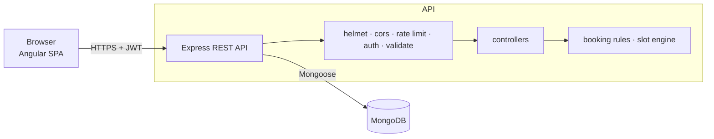

# Service Hub

A full-stack **service-booking platform** with three roles: **customers** book home services, **service providers** manage their bookings, services and working hours, and **admins** approve providers and oversee everything.

**Live demo:** _add your link after deployment, e.g. https://www.yourdomain.com_

| Role | Demo email | Password |
|---|---|---|
| Customer | `customer@demo.com` | the `SEED_PASSWORD` you set |
| Provider | `provider@demo.com` | the `SEED_PASSWORD` you set |
| Admin | `admin@demo.com` | the `SEED_PASSWORD` you set |

---

## Features

**Public website**
- Sticky header with dropdown mega menus (Services, Industries, For providers, Resources) and a mobile menu
- Home page: search, customer/provider preview toggle, live stats, tabbed features, industries, real customer reviews carousel, newsletter, FAQ
- Pages: How it works, For providers, Pricing (monthly/yearly), Industries (6 detail pages), Help center with search and articles, FAQ, Blog, About, Contact form, Trust & safety, Terms, Privacy
- All page text lives in `frontend/src/app/content/site-content.ts`, so you can edit copy without touching components

**Customer**
- Browse and search services by category, city and price
- Pick a date and a free time slot (booked slots are greyed out)
- Book with address and notes; booking starts as **Pending**
- My Bookings (upcoming / past / cancelled) with a **status timeline**
- Cancel up to 2 hours before the slot; rate and review completed bookings
- In-app notifications when the status changes

**Service provider**
- Registers as a provider and waits for admin approval
- Dashboard: today's bookings, pending requests, monthly earnings, rating
- Accept / reject requests, mark bookings completed or no-show
- Add, edit, hide and delete services
- Weekly working hours, lunch breaks, slot interval and leave days

**Admin**
- Dashboard: bookings, revenue, providers, customers, bookings-per-day chart, status breakdown, top services
- Approve or reject provider applications
- Manage categories, hide services, block or unblock users
- Search all bookings and change any booking's status

**Engineering highlights**
- **Double-booking is impossible**, even when two people click the same slot at the same moment: a MongoDB unique index on `{ providerId, slotKeys }` for active bookings ([how it works](docs/DATABASE.md#how-double-booking-is-prevented))
- Role-based permissions enforced **on the server** (JWT + `authorize()` middleware + per-booking ownership checks)
- Booking status rules in one tested module (`backend/src/utils/bookingRules.js`)
- All request bodies and query strings validated with Joi; consistent `{ success, data, meta }` responses
- Times stored in UTC, slots calculated in the business timezone (Asia/Kolkata)
- Angular standalone components, signals, reactive forms, lazy-loaded routes, route guards and HTTP interceptors

## Tech stack

| Layer | Technology |
|---|---|
| Frontend | Angular 22 (standalone components, signals, reactive forms, lazy routes), TypeScript, CSS |
| Backend | Node.js, Express 4, Joi, JSON Web Tokens, bcrypt, Helmet, CORS, rate limiting, Luxon |
| Database | MongoDB with Mongoose 9 |
| Testing | Jest, Supertest, mongodb-memory-server |
| Hosting (suggested) | Vercel (frontend), Render (API), MongoDB Atlas (database) |

## Architecture



More detail: [docs/ARCHITECTURE.md](docs/ARCHITECTURE.md)

## Project structure

```
service-hub/
├─ backend/
│  ├─ src/
│  │  ├─ config/         env + database connection
│  │  ├─ models/         User, ProviderProfile, Category, Service, Availability, Booking, Review, Notification
│  │  ├─ middleware/     auth (JWT + roles), validate (Joi), error handler
│  │  ├─ validators/     Joi schemas for every request
│  │  ├─ controllers/    auth, public, booking, review, provider, admin, notification
│  │  ├─ services/       catalog + slot lookups
│  │  ├─ utils/          slots.js, bookingRules.js, helpers
│  │  ├─ routes/         all API routes in one place
│  │  └─ seed/seed.js    demo data
│  ├─ tests/             unit + integration tests
│  └─ .env.example
├─ frontend/
│  └─ src/app/
│     ├─ core/           api, auth, data services, guards, interceptors, models
│     ├─ content/        website copy: industries, FAQ, help articles, blog, plans
│     ├─ layout/         mega-menu header, footer, public layout, portal shell
│     ├─ shared/         status badge, service card, pager, toasts
│     └─ features/       public, site (marketing pages), auth, customer, provider, admin
└─ docs/                 API, database, architecture, deployment, testing
```

## Run it locally on Windows

### 1. Install the tools (once)
- **Node.js 20 or newer** (LTS): https://nodejs.org — check with `node -v`
- **MongoDB Community Server**: https://www.mongodb.com/try/download/community (tick "Install as a Service"), **or** a free MongoDB Atlas cluster
- **Git**: https://git-scm.com

### 2. Backend (Command Prompt or PowerShell)
```bat
cd service-hub\backend
npm install
copy .env.example .env
```
Open `backend\.env` and set at least:
- `MONGODB_URI` — `mongodb://127.0.0.1:27017/service_hub` for local MongoDB, or your Atlas connection string
- `JWT_SECRET` — any long random text
- `SEED_PASSWORD` — the password for the demo accounts

Then:
```bat
npm run seed
npm run dev
```
The API runs on http://localhost:5000. Check http://localhost:5000/api/health.

### 3. Frontend (a second terminal)
```bat
cd service-hub\frontend
npm install
npm start
```
Open http://localhost:4200 and log in with a demo account.

> PowerShell blocks `npm` scripts? Run `Set-ExecutionPolicy -Scope CurrentUser RemoteSigned` once, or use Command Prompt.

## Scripts

| Folder | Command | What it does |
|---|---|---|
| backend | `npm run dev` | API with auto-restart (nodemon) |
| backend | `npm start` | API for production |
| backend | `npm run seed` | **Deletes** all data and loads demo data |
| backend | `npm test` | Unit + integration tests (downloads an in-memory MongoDB the first time) |
| frontend | `npm start` | Dev server on port 4200 |
| frontend | `npm run build` | Production build in `dist/frontend/browser` |

## API endpoints (summary)

Base URL: `/api`. 🔒 = needs `Authorization: Bearer <token>`. Full reference with examples: [docs/API.md](docs/API.md)

| Method | Endpoint | Who | Purpose |
|---|---|---|---|
| POST | `/auth/register` | public | Register a customer or provider |
| POST | `/auth/login` | public | Log in, returns JWT |
| GET | `/auth/me` | 🔒 any | Current user |
| GET | `/categories` | public | Active categories with service counts |
| GET | `/services` | public | Search services (`q`, `category`, `city`, `sort`, `page`) |
| GET | `/services/:id` | public | Service details |
| GET | `/services/:id/slots?date=YYYY-MM-DD` | public | Slots for a date with availability |
| GET | `/providers/:id` | public | Provider profile, services, reviews |
| GET | `/site/stats` | public | Homepage numbers (providers, completed jobs, rating) |
| GET | `/site/reviews` | public | Recent 4–5 star reviews for the carousel |
| POST | `/site/newsletter` | public | Newsletter signup |
| POST | `/site/contact` | public | Contact form (rate-limited, bot honeypot) |
| POST | `/bookings` | 🔒 customer | Book a slot |
| GET | `/bookings/my` | 🔒 customer | My bookings (`status=upcoming\|past\|cancelled…`) |
| GET | `/bookings/:id` | 🔒 owner/admin | Booking details + history |
| PATCH | `/bookings/:id/status` | 🔒 customer/provider/admin | Change status (rules apply) |
| POST | `/reviews` | 🔒 customer | Review a completed booking |
| GET | `/notifications` | 🔒 any | Latest notifications |
| GET/PUT | `/provider/profile` | 🔒 provider | Business profile |
| GET | `/provider/stats` | 🔒 provider | Dashboard numbers |
| GET/POST | `/provider/services` | 🔒 provider | List / add services |
| PUT/DELETE | `/provider/services/:id` | 🔒 provider | Edit / delete a service |
| GET/PUT | `/provider/availability` | 🔒 provider | Working hours, breaks, leave days |
| GET | `/provider/bookings` | 🔒 provider | Bookings for my services |
| GET | `/admin/stats` | 🔒 admin | Dashboard numbers (`days=7`) |
| GET | `/admin/providers` | 🔒 admin | Provider applications |
| PATCH | `/admin/providers/:id/approval` | 🔒 admin | Approve or reject |
| GET/POST | `/admin/categories` | 🔒 admin | List / add categories |
| PUT/DELETE | `/admin/categories/:id` | 🔒 admin | Edit / delete category |
| GET | `/admin/services` | 🔒 admin | All services |
| PATCH | `/admin/services/:id/active` | 🔒 admin | Show / hide a service |
| GET | `/admin/users` | 🔒 admin | Users (`role`, `q`) |
| PATCH | `/admin/users/:id/status` | 🔒 admin | Block / unblock |
| GET | `/admin/messages` | 🔒 admin | Contact form messages + subscriber count |
| PATCH | `/admin/messages/:id` | 🔒 admin | Mark replied / closed / new |
| GET | `/admin/bookings` | 🔒 admin | All bookings (`status`, `q`) |

## Testing

- Automated: `cd backend && npm test` — covers slot generation, status rules, auth, role checks, the booking flow, a **simultaneous double-booking race**, cancellation freeing a slot, and admin actions.
- Manual checklist for all three roles: [docs/TESTING.md](docs/TESTING.md)

## Deployment

Step-by-step guide (MongoDB Atlas + Render + Vercel + `www` domain with HTTPS): [docs/DEPLOYMENT.md](docs/DEPLOYMENT.md)

## Documentation

- [API reference](docs/API.md)
- [Database design](docs/DATABASE.md)
- [Architecture and design decisions](docs/ARCHITECTURE.md)
- [Deployment guide](docs/DEPLOYMENT.md)
- [Testing guide](docs/TESTING.md)

## License

MIT
