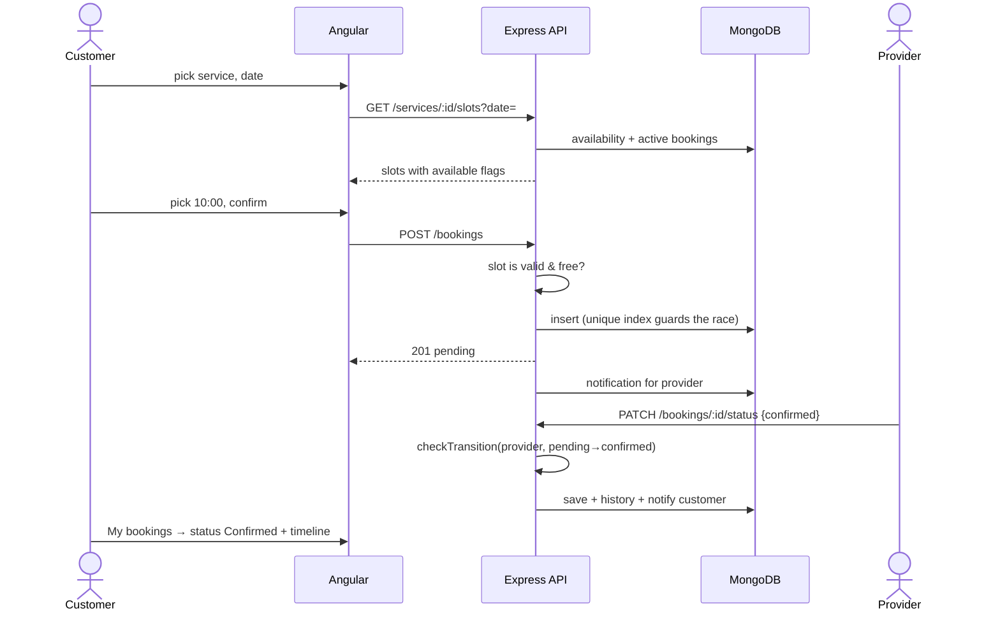
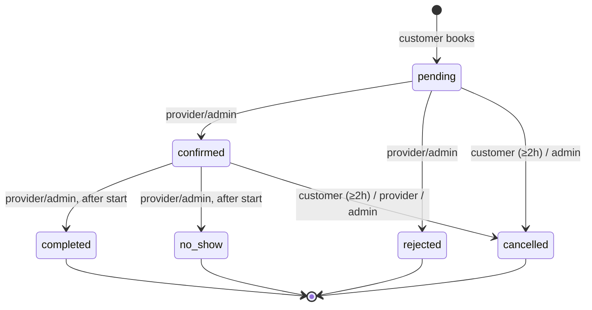

# Architecture and design decisions

## System overview

```mermaid
flowchart TB
  subgraph Client["Browser - Angular SPA (Vercel)"]
    UI[Standalone components] --> DS[DataService / AuthService]
    DS --> INT[Interceptors: add JWT, handle 401]
    G[Route guards: auth / role / guest] -.-> UI
  end
  INT -- HTTPS JSON --> API
  subgraph API["Express REST API (Render)"]
    direction TB
    MW1[helmet · CORS allow-list · JSON limit · rate limit on auth]
    MW2["authenticate (JWT → load user) · authorize(role)"]
    MW3[validate (Joi)]
    CT[controllers]
    RL["utils: bookingRules · slots (pure, unit-tested)"]
    EH[central error handler]
    MW1 --> MW2 --> MW3 --> CT --> RL
    CT --> EH
  end
  CT -- Mongoose --> DB[(MongoDB Atlas)]
```

## The three roles

| | Customer | Provider | Admin |
|---|---|---|---|
| Created by | self-register | self-register, then admin approval | seed script or database only |
| Sees | public catalog, own bookings | own services, schedule, bookings | everything |
| Can change bookings | cancel own (≥2 h before) | confirm/reject/complete/no-show/cancel own | any valid transition |

## Main flow



## Booking status machine



All rules live in `backend/src/utils/bookingRules.js` as one pure function, `checkTransition()`. It is unit-tested, and every route that changes a booking goes through it.

## Key decisions

| Decision | Why |
|---|---|
| **Database-level double-booking guard** (unique partial index on `slotKeys`) | An application-level check alone has a race condition. The index makes the database the source of truth. See [DATABASE.md](DATABASE.md#how-double-booking-is-prevented). |
| **Slots calculated on request, not stored** | Changing working hours or adding leave takes effect immediately. There are no thousands of slot documents to keep in sync. |
| **UTC in the database, business timezone for slots** | Correct results regardless of server or browser timezone. The frontend shows all times in IST (`DATE_PIPE_DEFAULT_OPTIONS`). |
| **Snapshot of price/title on each booking** | A provider raising prices must not change what past customers paid. |
| **Role read from the database on every request** | A blocked user or changed role takes effect immediately, even with an old token. |
| **404 instead of 403 for other people's bookings** | Doesn't reveal that a booking id exists. |
| **Same error for wrong email or wrong password** | Prevents discovering which emails are registered. |
| **Rate limit on login/register** | Slows down password guessing. |
| **Hide instead of delete** for services and categories with history | Old bookings keep valid references. |
| **One response envelope** `{ success, data, meta }` | The frontend unwraps it in one place (`ApiService`). |
| **Angular signals for state** | Works with Angular's zoneless change detection, no manual subscriptions in templates. |
| **Lazy-loaded provider and admin sections** | Customers never download admin code. The initial bundle is about 85 kB gzipped. |
| **Guards in the UI, permissions in the API** | Guards are for a smooth experience. Security is enforced only on the server. |

## Security checklist

- [x] Passwords hashed with bcrypt, never returned
- [x] JWT secret and database URL in environment variables (`.env.example` holds placeholders only)
- [x] Helmet security headers
- [x] CORS allow-list (`CORS_ORIGINS`)
- [x] Joi validation with unknown fields stripped; JSON body limit of 100 kB
- [x] Regex inputs escaped, so search can't inject patterns
- [x] Ownership checks on every booking, service and profile route
- [x] Rate limiting on authentication
- [x] Generic 500 messages in production (details only in server logs)

## What I would add next

- Online payments (Razorpay or Stripe) with a "paid" status
- Email or SMS reminders 24 hours before a booking (job queue)
- Reschedule as one atomic action instead of cancel + rebook
- Multiple staff per provider (each with their own calendar)
- Image uploads for services (Cloudinary or S3)
- Refresh tokens in httpOnly cookies instead of localStorage
