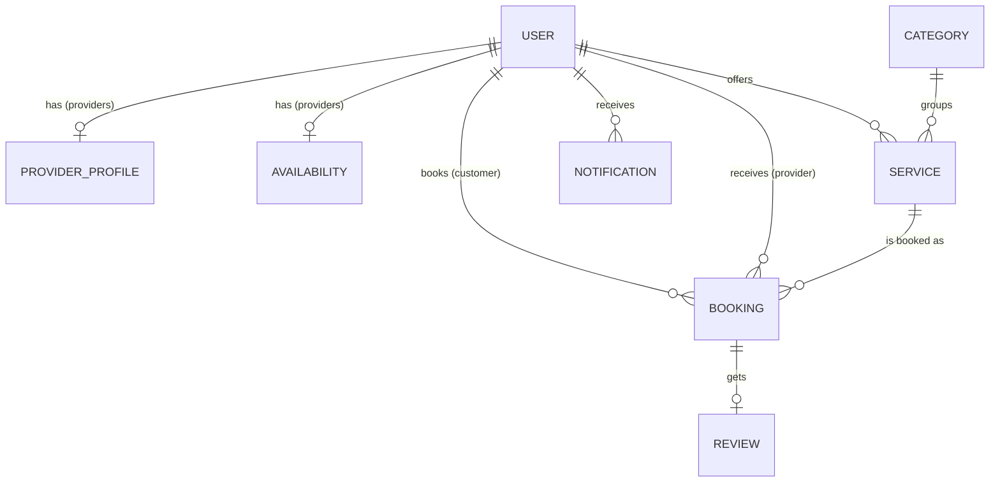

# Database design

MongoDB with Mongoose. Ten collections.



## Collections

### users
| Field | Type | Notes |
|---|---|---|
| name | String | required |
| email | String | **unique**, lowercase |
| phone | String | |
| passwordHash | String | bcrypt, never returned (`select: false`) |
| role | `customer` \| `provider` \| `admin` | indexed |
| isActive | Boolean | `false` = blocked |

### providerprofiles
One per provider user. `userId` (**unique**), `businessName`, `bio`, `city`, `experienceYears`, `approvalStatus` (`pending`/`approved`/`rejected`, indexed), `approvalNote`, `avgRating`, `totalReviews` (kept up to date when reviews are added).

### categories
`name`, `slug` (**unique**, generated from the name), `description`, `isActive`.

### services
`providerId`, `categoryId` (both indexed), `title`, `description`, `price`, `durationMinutes` (15–600), `imageUrl`, `isActive`.

A service is **bookable** only if it is active, its category is active, and its provider is approved and not blocked.

### availabilities
One per provider (`providerId` **unique**).
```js
{
  slotIntervalMinutes: 60,            // grid size: 15, 30 or 60
  weekly: [{ day: 1, isOpen: true, start: '09:00', end: '18:00', breakStart: '13:00', breakEnd: '14:00' }, …], // 0 = Sunday
  leaves: ['2026-12-25']              // days off, YYYY-MM-DD in the business timezone
}
```
Slots are **calculated, not stored**: working hours minus breaks, leave days, past times and active bookings.

### bookings
| Field | Notes |
|---|---|
| code | **unique** readable id, e.g. `SH-M3K2ABX7Q` |
| customerId, providerId | indexed |
| serviceId | |
| serviceTitle, price, durationMinutes | **copied from the service** when booked, so later price edits don't change old bookings |
| startTime (indexed), endTime | UTC |
| address, notes | |
| status | `pending`, `confirmed`, `completed`, `cancelled`, `rejected`, `no_show` |
| statusHistory | `[{ status, byUserId, byRole, note, at }]`, the audit trail shown as the timeline |
| cancelReason | |
| slotKeys | `[String]`: UTC start of every grid cell this booking covers |
| slotLocked | `true` while status is `pending` or `confirmed` (set automatically) |
| reviewed | |

### reviews
`bookingId` (**unique**, so one review per booking), `customerId`, `providerId` (indexed), `serviceId`, `rating` (1–5), `comment`.

### notifications
`userId` (indexed), `type`, `message`, `link`, `isRead`.

### subscribers
`email` (**unique**), `source`. Newsletter signups.

### contactmessages
`name`, `email`, `topic`, `message`, `status` (`new`/`replied`/`closed`, indexed). Contact-form messages for admins.

---

## How double-booking is prevented

Checking "is this slot free?" and then inserting is not enough. Two requests can both pass the check before either one saves. Service Hub lets **the database** enforce it.

1. Each provider's day is a grid of cells (`slotIntervalMinutes`, e.g. 60 minutes).
2. When a booking is made, the server stores the start time of **every cell it covers** in `slotKeys`. For example, a 2-hour job at 10:00 IST stores `["…T04:30:00Z", "…T05:30:00Z"]`.
3. A unique index covers active bookings only:
   ```js
   bookingSchema.index(
     { providerId: 1, slotKeys: 1 },
     { unique: true, partialFilterExpression: { slotLocked: true }, name: 'no_double_booking' }
   );
   ```
   Because `slotKeys` is an array, MongoDB treats each element as its own index entry, so **no two active bookings of the same provider can share any cell**. This also blocks overlapping bookings of different lengths.
4. If two requests race, the second insert fails with error `11000`, and the API returns `409 Conflict`. The UI refreshes the slots and asks the user to pick another time.
5. When a booking is cancelled or rejected, `slotLocked` becomes `false`. It drops out of the partial index, and the slot is free again at once.

The integration test `two customers racing for one slot: exactly one wins` proves this.

## Indexes summary

| Collection | Index | Why |
|---|---|---|
| users | `email` unique | login, no duplicate accounts |
| providerprofiles | `userId` unique, `approvalStatus` | one profile per provider, admin filter |
| categories | `slug` unique | clean URLs, no duplicates |
| services | `providerId`, `categoryId`, text(`title`, `description`) | listing and filters |
| availabilities | `providerId` unique | one schedule per provider |
| bookings | `{providerId, slotKeys}` unique partial, `customerId`, `providerId`, `startTime`, `status`, `code` unique | double-booking guard, lists, date ranges |
| reviews | `bookingId` unique, `providerId` | one review per booking, provider page |
| notifications | `userId` | inbox |

## Seed data (`npm run seed`)

- 6 categories (Painting inactive)
- 1 admin, 2 customers, 6 providers (4 approved, 2 pending)
- 9 services
- 8 bookings covering every status (completed with a review, completed without a review, cancelled, confirmed, pending)

**The seed script deletes all existing data first.** It refuses to run when `NODE_ENV=production` unless you pass `--force`.
